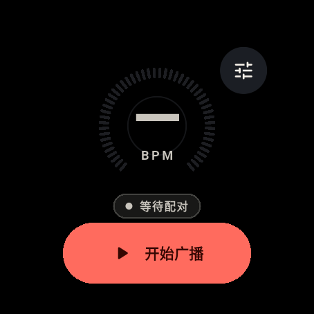
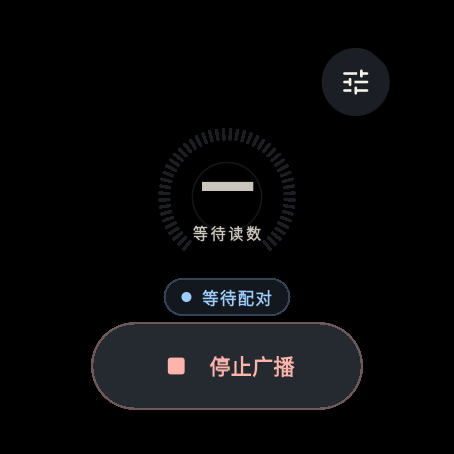
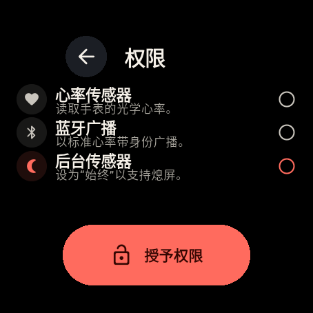
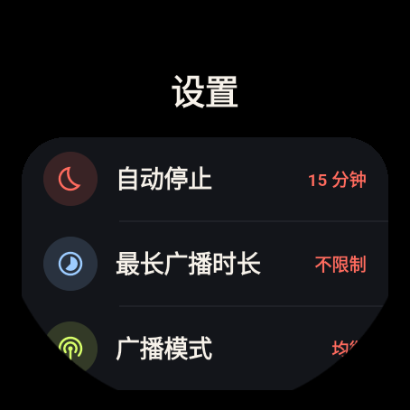

<p align="center">
  
</p>

# BeatCast

把手表变成一条标准蓝牙心率带。

BeatCast 是一个独立的 Wear OS 应用（包名 `com.zihuagaochn.beatcast`），用 Flutter 构建，面向 **不支持心率广播** 的手表（例如 Samsung Galaxy Watch 系列）。它读取手表的光学心率传感器，通过 BLE 外设模式广播 Bluetooth SIG 标准 **Heart Rate Service (0x180D)**，让跑步机、动感单车、码表、健身 App 像连接普通心率带一样连接手表。

> 无需手机中转，心率数据不离开手表与健身设备之间的蓝牙链路。

## 特性

- **标准 BLE 心率带**：Heart Rate Service `0x180D` + Heart Rate Measurement `0x2A37`（Notify / Read），附带 Body Sensor Location 与 Device Information Service。
- **独立运行**：传感器、GATT Server、广播都在手表的原生前台服务中，Flutter 界面退出、屏幕熄灭后继续工作。
- **低功耗设计**
  - 只有设备真正连接后才启动 PPG 传感器；最后一个设备断开即释放传感器与唤醒锁。
  - 优先使用 wake-up 心率传感器，采样节流到约 1 Hz，BLE 只发送 2 字节的 BPM 测量值。
  - 默认 15 分钟无连接自动停止；可选最长广播时长，避免忘记关闭。
  - 低功耗广播模式（更长广播间隔、低发射功率）可选。
  - 屏幕熄灭后 Flutter 不产生帧；界面只保留必要动画。
- **Material 3 Expressive**：针对方圆表盘重新排版的大号 BPM、分层表盘环、弹性按压反馈、语义化色彩和弹性转场。
- **中文 / English** 双语界面，跟随系统语言。
- **权限引导**：首次启动自动拉起系统权限对话框，后续可在应用内权限页补充设置；覆盖 Android 12–16 的蓝牙、通知、传感器及后台传感器权限差异，包括 API 36 的 `android.permission.health.READ_HEART_RATE` 迁移。
- **系统默认字体**：使用系统 `sans-serif`，中文字形走系统 Noto fallback；BPM 数字取消负字距，避免相邻数字粘连。
- **低重绘**：移除每秒计时刷新与 BPM 切换动画，减少低功耗手表上的掉帧。
- **无第三方 Flutter 依赖**：除 Flutter SDK 与 `flutter_localizations` 外没有运行时插件，减小安装包与启动开销。

## 截图

> 以下截图来自 Wear OS 5 模拟器（454 × 454，227 dp）。模拟器没有 PPG 与真实 BLE 接收端，因此展示的是空闲、等待配对和权限流程；真实手表上会显示实时 BPM 与连接设备数量。

| 首页 | 广播中 |
| --- | --- |
|  |  |

| 权限引导 | 设置 |
| --- | --- |
|  |  |

## 使用

1. 在手表上安装并打开 BeatCast。
2. 按引导授予：
   - 心率传感器权限；
   - 蓝牙连接 / 广播权限；
   - 通知权限；
   - **后台传感器权限**（设置为“始终允许”）。
3. 点 **开始广播**。屏幕可以熄灭。
4. 在跑步机、码表或健身 App 中选择“添加心率传感器”，找到手表的蓝牙名称并连接。
5. 设备连接后，首页显示实时 BPM；断开后传感器会自动休眠。

停止广播可以直接在首页或常驻通知中操作。

## 构建

要求：Flutter 3.41+、Android SDK 36、JDK 17、Kotlin 2.2+。界面同时适配 227 dp 圆表与更大表盘。

```bash
flutter pub get
flutter analyze
flutter test
flutter build apk --release --target-platform android-arm,android-arm64
```

产物：`build/app/outputs/flutter-apk/app-release.apk`。

当前 `android/app/build.gradle.kts` 的 release 构建使用 debug 签名，便于个人手表侧载。发布到应用商店前请替换为自己的签名配置。

### 安装到手表

```bash
# 手表开启开发者选项与“通过 Wi-Fi 调试”
adb connect <watch-ip>:5555
adb install -r BeatCast-1.0.0-arm64-armv7.apk
```

Galaxy Watch 4/5/6/7 等运行 Wear OS 3+ 的设备均可侧载。手表需要支持 BLE 外设广播；如果厂商固件禁用了外设模式，应用会显示对应错误。

预构建 APK 请在 GitHub Releases 中下载（约 34 MB，同时包含 `arm64-v8a` 和 `armeabi-v7a`，兼容 32 位手表）。

## 架构

```
Flutter UI (Material 3 Expressive)
        │  MethodChannel / EventChannel
        ▼
MainActivity ──────────────── BeatCastService (Foreground Service)
                                  │
                    ┌─────────────┴─────────────┐
                    ▼                           ▼
          HeartRateSensor                 BleBroadcaster
      TYPE_HEART_RATE (wake-up)      GATT Server + Advertiser
     1 Hz, only with a client        HRS 0x180D / HRM 0x2A37
```

- **`BeatCastService`**：唯一的状态拥有者。负责前台通知、唤醒锁、空闲/会话超时、蓝牙开关监听和生命周期。
- **`HeartRateSensor`**：直接读取 `Sensor.TYPE_HEART_RATE`，优先 wake-up 传感器，约 1 秒采样并节流。
- **`BleBroadcaster`**：打开 GATT Server、注册标准服务、广播 `0x180D`、处理 CCCD 订阅与 Notify。
- **`BroadcastStateStore`**：进程内状态总线；Flutter 通过 EventChannel 订阅，Activity 销毁不影响服务。
- **`MainActivity`**：权限、服务控制、能力检测、状态序列化；不持有传感器或 BLE 资源。

### BLE 协议

| 项目 | 值 |
| --- | --- |
| Heart Rate Service | `0000180D-0000-1000-8000-00805F9B34FB` |
| Heart Rate Measurement | `00002A37-...`，Read + Notify |
| Body Sensor Location | `00002A38-...`，值 `0x02`（手腕） |
| Device Information | `0x180A`：Manufacturer / Model / Firmware |
| Measurement 格式 | Flags `0x06`（uint8 + 接触检测/已接触）或 `0x04`（未接触）+ 1 字节 BPM |
| 广播 | Connectable，包含 `0x180D`；设备名放在 scan response |

## 功耗模型

| 场景 | 行为 |
| --- | --- |
| 未开始 | 无服务、无广播、无传感器 |
| 广播中、无设备 | 仅 BLE 控制器低占空比广播；CPU 可休眠；无唤醒锁 |
| 设备已连接 | 启动 wake-up PPG（1 Hz），持有 `PARTIAL_WAKE_LOCK`，BLE 每秒 2 字节 Notify |
| 屏幕熄灭 | 原生服务继续；Flutter 不渲染；Dart 计时器暂停 |
| 设备断开 | 立即注销传感器、释放唤醒锁；按设置空闲计时 |
| 空闲/超时 | 停止前台服务与广播 |

实际续航取决于手表型号、PPG 硬件、连接间隔和广播模式。连续广播属于高功耗场景，建议不用时停止。

## 兼容性与限制

- 需要手表固件支持 **BLE 外设广播**。Wear OS 设备能力由厂商实现决定；如果广播启动失败，应用会给出错误码提示。
- 部分厂商在手表与手机保持蓝牙连接时会限制第三方 BLE 广播。遇到此类固件限制时，可尝试断开手机蓝牙后重试；这是系统级限制，应用无法绕过。
- 使用原始 `TYPE_HEART_RATE` 传感器，而非 Health Services 的批量接口；后者在熄屏时会批量延迟数据，不适合实时心率带场景。
- 目前为**手表直连**模式，不包含手机桥接。若某款手表完全不支持 BLE 外设模式，后续可增加“手表 → 手机 → BLE 广播”的伴生模式。
- 仅广播 BPM；暂不包含 RR interval、能量消耗等扩展字段。
- 不是医疗器械，不用于诊断或治疗。

## 测试

```bash
flutter analyze
flutter test
cd android && ./gradlew testDebugUnitTest
```

已覆盖：
- 状态/权限/设置解析；
- 启动、权限申请、蓝牙关闭、后台权限失败等控制器路径；
- 首页、权限引导、设置页的 Widget 流程；
- 227 dp 圆表布局（454 px @ 2x）；
- BLE Heart Rate Measurement 字节编码。

在 Wear OS 5 模拟器上额外验证了：前台服务启动、传感器/GATT 权限链路、标准 HRS/Device Information 服务注册、BLE 广播启动、常驻通知、首页状态同步与停止清理。

真实 PPG 读数、真实 BLE 连接、不同厂商的 GATT 行为与功耗表现仍需在实体 Wear OS 手表上验证。

## 目录

```
lib/
  core/            models / platform channel / state controller / theme
  features/        home / permissions / settings
  l10n/            中英文字符串
  shared/          watch scaffold, ring, button, badge
android/app/src/main/kotlin/com/zihuagaochn/beatcast/
  BeatCastService.kt
  ble/BleBroadcaster.kt
  sensor/HeartRateSensor.kt
  core/            state store, settings, permissions, notifications
  model/           snapshot + HR measurement encoder
```

## 隐私

BeatCast 不联网、不上传、不持久化心率数据。所有读数只存在于内存，并通过本地 BLE 连接发送给已订阅的健身设备。


## 许可证

本项目使用 [MIT License](LICENSE) 开源。

应用图标使用 Google Material Symbols（Apache-2.0），第三方依赖与图标许可见
[THIRD_PARTY_NOTICES.md](THIRD_PARTY_NOTICES.md)。

BeatCast 与 Samsung、Google 等厂商没有隶属或官方合作关系；相关商标归各自权利人所有。

## 第三方资源

- 应用图标使用 Google Material Symbols（Apache-2.0）中的 `favorite` 与 `link` 图形。
